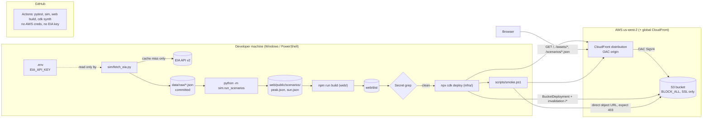
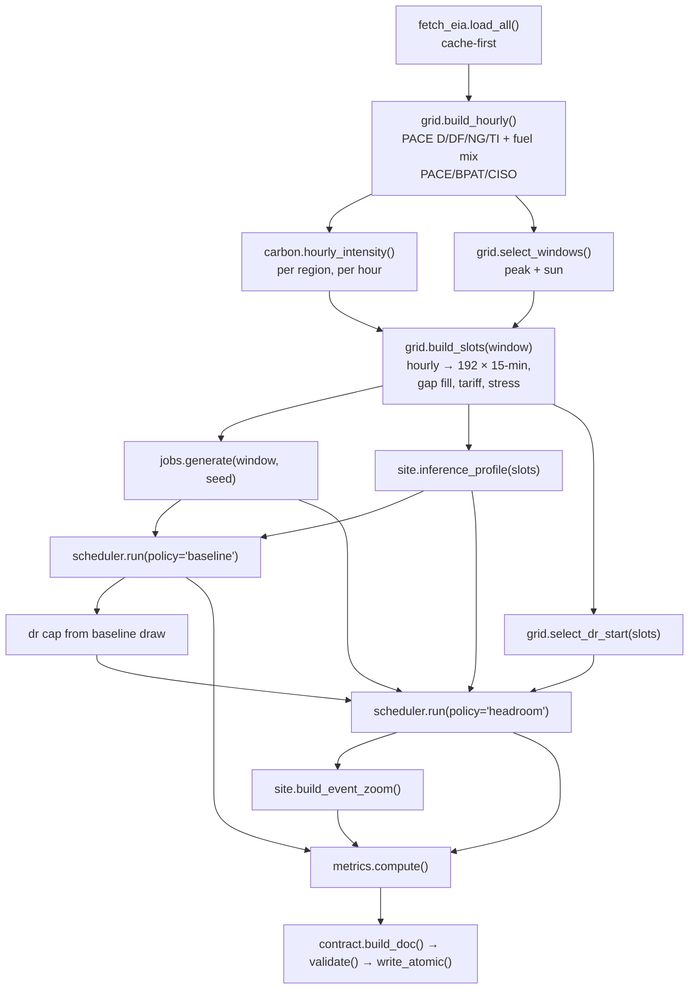
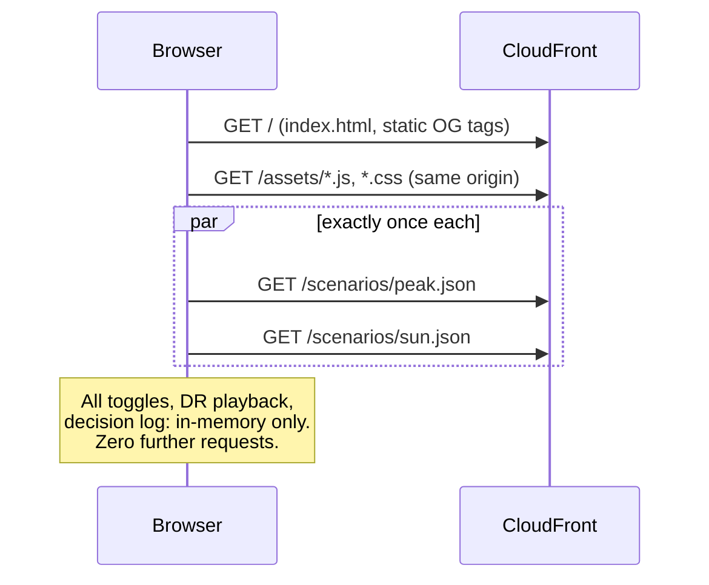
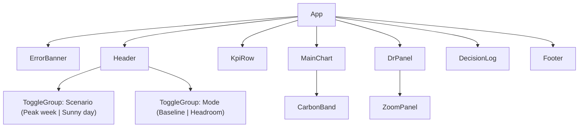

# Design Document: Headroom

## Overview

Headroom is a build-time simulation plus a static single-page app. A Python pipeline reads cached EIA-930 data for PacifiCorp East (`PACE`), simulates a 10 MW AI site under two scheduling policies (`baseline` and `headroom`), and writes two static JSON files (`peak.json`, `sun.json`). A Vite + React + TypeScript app loads those two files once and renders the story. AWS CDK v2 (TypeScript) deploys the built app to a private S3 bucket behind CloudFront. Nothing runs on a server at demo time.

The design is for a one-day hackathon build, so it favours:

- **Transparency over optimality.** The `headroom` policy is a greedy, slot-by-slot router whose every choice is explained by a reason string. A linear program (`pulp`) is a fallback only if the stress-hour peak test (Requirement 23.6) cannot be made to pass.
- **Determinism.** One seeded RNG per purpose, integer minutes and integer kW for job arithmetic, fixed float rounding and fixed key order in JSON. Same seed + same cache → byte-identical files (ignoring `meta.built_at`).
- **Offline by construction.** The EIA API is touched only by `sim/fetch_eia.py` on the developer's machine. CI, tests and builds read the committed `data/raw/` cache. The browser makes exactly two requests for data, then none.
- **Deploy first.** The infrastructure and deploy/smoke scripts are built and proven with a placeholder page before any simulation work (Requirement 5).

The story every component serves: the AI site becomes a flexible grid asset instead of a grid problem.

### Research notes that shape the design

- **CloudFront + S3 with OAC.** `S3BucketOrigin.withOriginAccessControl(bucket)` in `aws-cdk-lib/aws-cloudfront-origins` creates the Origin Access Control and the scoped bucket policy for the distribution; the legacy OAI path is discouraged ([CDK S3BucketOrigin docs](https://docs.aws.amazon.com/cdk/api/v2/docs/aws-cdk-lib.aws_cloudfront_origins.S3BucketOrigin.html), [AWS DevOps blog on the OAC L2 construct](https://aws.amazon.com/jp/blogs/devops/a-new-aws-cdk-l2-construct-for-amazon-cloudfront-origin-access-control-oac/)). This API needs a recent `aws-cdk-lib` 2.x; if the installed version lacks it, Requirement 1.11 applies (adapt and log).
- **BucketDeployment** copies a local asset directory into the bucket and, when given `distribution` + `distributionPaths`, creates a CloudFront invalidation after upload ([BucketDeployment docs](https://docs.aws.amazon.com/cdk/api/v2/docs/aws-cdk-lib.aws_s3_deployment.BucketDeployment.html)). Its Lambda-backed custom resource is CDK-managed and allowed by Requirement 1.15.
- **With OAC and no `s3:ListBucket`, S3 returns 403 (not 404) for missing keys.** That is why the 403 → `/index.html` (200) error response matters, and why the smoke test must parse `/scenarios/peak.json` as JSON instead of trusting the status (Requirement 3.2).
- **EIA API v2.** The API returns at most 5,000 rows per JSON request; the response carries a `total` field and paging is done with `offset` ([EIA Open Data FAQ](https://www.eia.gov/opendata/faqs.php), [API technical documentation](https://www.eia.gov/opendata/documentation.php)). Hourly (`frequency=hourly`) periods are UTC strings shaped `YYYY-MM-DDTHH`. Row `value` fields can arrive as strings or `null`, so parsing must coerce and tolerate missing values. The response echoes the request parameters, so the cached copy must have any `api_key` field stripped before it is written (Requirement 6.9, 7.15). Rows themselves are never changed (Requirement 7.5).
- **Volume.** PACE region data is 4 types × 2,928 hours ≈ 11.7k rows (3 pages). Fuel-type data is roughly 8 fuels × 2,928 hours per respondent ≈ 23k rows (5 pages each). Total fetch is about 18 requests, done once.
- **EIA-930 hour labelling.** EIA-930 is published with hour-ending conventions in some views. The requirements fix the interpretation: a `period` is parsed as a UTC timestamp and its value is assigned to the four slots of that hour (Requirements 7.10, 7.12). The possible one-hour shift is logged in `DECISIONS.md`; it does not change any conclusion.
- **Windows time zones.** Python's `zoneinfo` on Windows has no system IANA database, so `tzdata` is a pinned dependency. The browser side uses `Intl.DateTimeFormat` with `timeZone: 'America/Denver'`. The Data_Range (June–September 2026) contains no DST transition.
- **React StrictMode** runs effects twice in development. Data loading uses a module-level promise so each scenario file is requested exactly once even in dev (Requirement 17.1).
- **PowerShell 5.1 vs 7.** `Invoke-WebRequest` throws on 4xx in 5.1 and lacks `-SkipHttpErrorCheck`. The smoke script uses `System.Net.Http.HttpClient` so status handling and the 15-second timeout behave the same in both shells.

## Architecture

### System view



### Build-time pipeline



Order matters in one place: the DR cap is `baseline grid draw at DR start − 4,000 kW`, so the baseline policy runs before the headroom policy (Requirement 14.3).

### Runtime (browser) view



### Repository layout

```
headroom/
  README.md                  # live URL first, PowerShell setup/deploy, real-vs-simulated table, Duke line
  DECISIONS.md               # every judgment call, same commit as the change
  .gitignore                 # .env, node_modules/, cdk.out/, web/dist/, __pycache__/, .venv/, infra/cdk-outputs.json
  .env.example               # EIA_API_KEY=
  .github/workflows/ci.yml   # pytest → sim → web build → cdk synth; no AWS creds, no key
  scripts/
    deploy.ps1               # sim → web build → secret grep → cdk deploy → print URL → smoke
    smoke.ps1                # GET /, GET /scenarios/peak.json (JSON), direct S3 URL = 403
  data/raw/                  # cached EIA responses (committed, api_key stripped)
  data/processed/            # hourly merged series + carbon (generated, for sanity plots)
  sim/
    __init__.py
    requirements.txt         # exact pins: numpy, tzdata, pytest, hypothesis
    config.py                # ALL constants, each commented REAL or ILLUSTRATIVE
    timeutil.py              # UTC/Denver helpers, ISO 'Z' formatting, slot math
    fetch_eia.py             # the only reader of EIA_API_KEY
    grid.py                  # cache → hourly series, gap fill, windows, slots, stress, DR start
    carbon.py                # fuel mapping, average intensity
    jobs.py                  # seeded Poisson training jobs
    site.py                  # inference profile, storage devices, tariff, event zoom
    scheduler.py             # baseline + headroom behind one interface, reason strings
    metrics.py               # KPI formulas
    contract.py              # build/validate/serialize Scenario docs, atomic write
    run_scenarios.py         # orchestrator: python -m sim.run_scenarios
    tests/
      conftest.py            # no-network guard, session-built scenarios
      test_*.py
  web/
    index.html               # <title>, meta description, OG tags (static)
    package.json, package-lock.json, vite.config.ts, tsconfig.json
    public/scenarios/        # peak.json, sun.json (generated; committed)
    src/
      main.tsx, App.tsx, types.ts, config.ts
      data/loadScenarios.ts
      state/appState.ts
      lib/format.ts, lib/time.ts, lib/colors.ts, lib/useZoomPlayback.ts, lib/useReducedMotion.ts
      components/Header.tsx, ToggleGroup.tsx, KpiRow.tsx, MainChart.tsx, CarbonBand.tsx,
                 DrPanel.tsx, ZoomPanel.tsx, DecisionLog.tsx, Footer.tsx, ErrorBanner.tsx
  infra/
    bin/headroom.ts
    lib/site-stack.ts
    cdk.json                 # context: "headroom:region": "us-west-2"
    package.json, package-lock.json, tsconfig.json
```

`timeutil.py`, `grid.py` and `contract.py` are additions to the brief's layout. They keep `run_scenarios.py` a thin orchestrator and give the property tests small pure functions to target. This is logged in `DECISIONS.md`.

### Build order (maps to the brief's milestones)

1. **Walking skeleton (by 10:30):** `.gitignore`, `.env.example`, `infra/`, placeholder `web/` ("Headroom — coming online"), `deploy.ps1 -SkipSim` path with a stub `peak.json`/`sun.json`, `smoke.ps1`, CI, README with URL (Requirement 5).
2. **Data (10:30–12:30):** `fetch_eia.py`, `grid.py`, `carbon.py`, window selection, sanity plot from `data/processed/`.
3. **Simulation (12:30–3:00):** `jobs.py`, `site.py`, `scheduler.py`, `metrics.py`, `contract.py`, `run_scenarios.py`, tests green, deploy.
4. **UI (3:00–7:00):** wired to JSON, deploy after each increment.
5. **Polish (7:00–10:00):** zoom animation, a11y, layout, final deploy + smoke. Freeze at 22:00 MT.

The cut order (Requirement 24.5) is implemented with flags, see [Cut-order flags](#cut-order-flags).

## Components and Interfaces

### Python simulation (`sim/`)

All times inside the simulation are timezone-aware UTC `datetime`s. Slot indices are integers `0..N-1` (N = 192 for a real scenario; tests use smaller N). Job time quantities are integer minutes; job power is integer kW (IT). Facility power is IT power × PUE.

#### `sim/config.py`

Single source of constants. Every constant has a trailing `# REAL: <source>` or `# ILLUSTRATIVE` comment. No other module defines these values as literals (Requirement 10.1); a test greps `sim/*.py` (excluding `config.py` and `tests/`) for the key literals (for example `16000`, `0.085`, `4000`).

```python
# --- Run / reproducibility
SEED = 42                                  # ILLUSTRATIVE
ENABLE_SUN_SCENARIO = True                 # ILLUSTRATIVE (cut flag #2)
ENABLE_MOVE_REGION = True                  # ILLUSTRATIVE (cut flag #3)

# --- EIA (REAL: EIA-930 via EIA API v2)
EIA_BASE = "https://api.eia.gov/v2/electricity/rto"   # REAL
EIA_PAGE_LENGTH = 5000                     # REAL: API max rows per JSON page
HOME_REGION = "PACE"                       # REAL
ALT_REGIONS = ("BPAT", "CISO")             # REAL
REGION_TYPES = ("D", "DF", "NG", "TI")     # REAL
DATA_START = "2026-06-01T00"               # REAL (range choice per brief)
DATA_END = "2026-09-30T23"                 # REAL
DISPLAY_TZ = "America/Denver"              # REAL

# --- Emission factors gCO2eq/kWh
EMISSION_FACTORS = {
    "Coal": 820,        # REAL: IPCC AR5 lifecycle median
    "Natural gas": 490, # REAL: IPCC AR5 lifecycle median
    "Biomass": 230,     # REAL: IPCC AR5 lifecycle median
    "Solar": 48,        # REAL: IPCC AR5 lifecycle median
    "Hydro": 24,        # REAL: IPCC AR5 lifecycle median
    "Nuclear": 12,      # REAL: IPCC AR5 lifecycle median
    "Wind": 11,         # REAL: IPCC AR5 lifecycle median
    "Geothermal": 38,   # REAL: IPCC AR5 lifecycle median
    "Oil": 650,         # ILLUSTRATIVE
    "Other": 300,       # ILLUSTRATIVE
}
FUEL_CODE_MAP = {"COL": "Coal", "NG": "Natural gas", "NUC": "Nuclear", "OIL": "Oil",
                 "OTH": "Other", "SUN": "Solar", "WAT": "Hydro", "WND": "Wind"}  # REAL: EIA codes

# --- Time
WINDOW_HOURS = 48; SLOT_MINUTES = 15; SLOTS_PER_HOUR = 4   # ILLUSTRATIVE (brief)
STRESS_TOP_FRACTION = 0.05                 # ILLUSTRATIVE
LOOKAHEAD_SLOTS = 96                       # ILLUSTRATIVE (24 h)

# --- Facility
IT_PEAK_KW = 10_000                        # ILLUSTRATIVE
PUE = 1.3                                  # ILLUSTRATIVE
INFERENCE_SHARE = 0.35                     # ILLUSTRATIVE
INFERENCE_PEAK_HOUR_LOCAL = 18             # ILLUSTRATIVE (afternoon/evening peak)
INFERENCE_MIN_FRACTION = 0.60              # ILLUSTRATIVE (overnight floor as fraction of peak)
TRAINING_SHARE = 0.65                      # ILLUSTRATIVE

# --- Training jobs
JOB_POWER_KW = (50, 800); JOB_POWER_STEP_KW = 10          # ILLUSTRATIVE
JOB_DURATION_MIN = (60, 720); JOB_DURATION_STEP_MIN = 5   # ILLUSTRATIVE
JOB_SLACK_MIN = (360, 1440); JOB_SLACK_STEP_MIN = 15      # ILLUSTRATIVE
RESTART_PENALTY_MIN = 5                    # ILLUSTRATIVE
JOB_ID_BASE = 4001                         # ILLUSTRATIVE

# --- Storage
BATTERY = dict(power_kw=4000, capacity_kwh=16000, rte=0.90,
               soc_min_pct=10, soc_max_pct=95, soc_init_pct=60)   # ILLUSTRATIVE
FLYWHEEL = dict(power_kw=2000, capacity_kwh=500, rte=0.85,
                soc_min_pct=10, soc_max_pct=95, soc_init_pct=90)  # ILLUSTRATIVE
STORAGE_WEAR_USD_PER_KWH = 0.02            # ILLUSTRATIVE
CHARGE_RANK_FRACTION = 0.25                # ILLUSTRATIVE: charge only in cheapest/cleanest 25% of look-ahead
STRESS_DISCHARGE_KW = 2000                 # ILLUSTRATIVE: battery shave in forecast-stress slots

# --- Tariff (ILLUSTRATIVE, not Rocky Mountain Power's actual rates)
TARIFF_OFFPEAK_PER_KWH = 0.045             # ILLUSTRATIVE
TARIFF_ONPEAK_PER_KWH = 0.085              # ILLUSTRATIVE
ON_PEAK_HOURS_LOCAL = (15, 20)             # ILLUSTRATIVE, weekdays, [start, end)
DEMAND_CHARGE_PER_KW = 18.0                # ILLUSTRATIVE
CARBON_SHADOW_USD_PER_T = 50.0             # ILLUSTRATIVE

# --- Scheduler cost knobs
DEADLINE_RISK_USD_PER_KWH = 0.10           # ILLUSTRATIVE
DEADLINE_COMFORT_MIN = 240                 # ILLUSTRATIVE
DEFER_TARGET_STEP_SLOTS = 4                # ILLUSTRATIVE: candidate resume slots on the hour

# --- Demand response
DR_SHED_KW = 4000                          # ILLUSTRATIVE
DR_DURATION_SLOTS = 8                      # ILLUSTRATIVE (2 h)
DR_BATTERY_RAMP_S = 20                     # ILLUSTRATIVE
DR_ZOOM_SECONDS = 600                      # ILLUSTRATIVE
DR_STORAGE_SUPPORT_KW = 1500               # ILLUSTRATIVE: storage share of the shed (≤ flywheel power)
DR_RESERVE_MARGIN = 1.10                   # ILLUSTRATIVE

# --- MOVE_REGION
MOVE_PENALTY_USD = 75.0                    # ILLUSTRATIVE
MOVE_DELAY_SLOTS = 2                       # ILLUSTRATIVE (30 min)
IDLE_CAPACITY_PCT = (0, 30)                # ILLUSTRATIVE (SIMULATED per region-hour)
ALT_REGION_PRICE_PER_KWH = 0.05            # ILLUSTRATIVE

# --- Output rounding (decimal places)
ROUND = dict(kw=1, mw=1, carbon=1, price=4, pct=1, usd=2, t=3)  # ILLUSTRATIVE
```

Derived values (computed, not literals): facility peak `IT_PEAK_KW * PUE`, inference peak `IT_PEAK_KW * INFERENCE_SHARE`, expected training IT kW `IT_PEAK_KW * TRAINING_SHARE`, job arrival rate `λ = expected_training / (mean_power × mean_duration_h)` ≈ 2.35 jobs/hour.

#### `sim/timeutil.py`

```python
def parse_eia_period(p: str) -> datetime            # "2026-06-01T00" → UTC datetime
def iso_z(t: datetime) -> str                       # "2026-07-15T21:00:00Z"
def slot_times(start: datetime, n: int) -> list[datetime]
def denver(t: datetime) -> datetime                 # ZoneInfo("America/Denver") via tzdata
def hhmm_denver(t: datetime) -> str                 # "14:15"
def hour_floor(t: datetime) -> datetime
```

#### `sim/fetch_eia.py`

```python
@dataclass(frozen=True)
class RequestSpec:
    endpoint: Literal["region-data", "fuel-type-data"]
    respondent: str
    types: tuple[str, ...]     # () for fuel-type-data (all fuels)
    offset: int

def base_params(spec: RequestSpec) -> list[tuple[str, str]]   # never contains api_key
def cache_path(spec: RequestSpec) -> Path
def read_api_key() -> str          # env var first, then repo-root .env; raises MissingKeyError
def fetch_page(spec) -> dict       # cache-first; network only on miss
def load_all() -> dict[str, list[dict]]   # all pages for PACE region + 3 fuel mixes
def main() -> int                  # python -m sim.fetch_eia
```

Request parameters (Requirements 7.1–7.4):

| Param | Value |
|---|---|
| `frequency` | `hourly` |
| `data[0]` | `value` |
| `facets[respondent][]` | `PACE` (region-data); `PACE`, `BPAT`, `CISO` (fuel-type-data, one respondent per request series) |
| `facets[type][]` | `D`, `DF`, `NG`, `TI` (region-data only, repeated param) |
| `start` / `end` | `2026-06-01T00` / `2026-09-30T23` |
| `sort[0][column]` / `sort[0][direction]` | `period` / `asc` |
| `length` / `offset` | `5000` / `0, 5000, 10000, …` |
| `api_key` | appended only inside `_send()`; never in `base_params`, logs, or cache |

Pagination: request offset 0; while a page has exactly 5,000 rows, request `offset + 5000`; stop on fewer than 5,000 rows (including 0).

Cache naming (one file per endpoint/respondent/facets/offset, Requirement 7.5):

```
data/raw/region-data__PACE__D-DF-NG-TI__o000000.json
data/raw/region-data__PACE__D-DF-NG-TI__o005000.json
data/raw/fuel-type-data__BPAT__all__o010000.json
```

Key handling:

- `read_api_key()` checks `os.environ["EIA_API_KEY"]`, then parses `.env` at the repo root with a tiny `KEY=VALUE` reader (no extra dependency). Unset, empty or whitespace-only in both → `MissingKeyError`, exit code 2, message names `EIA_API_KEY` only (Requirements 6.2, 6.8, 7.14).
- The key is read lazily, only on the first cache miss. A fully cached run never reads `.env` (Requirement 7.7).
- Before writing a response: delete `api_key` from `response["request"]["params"]` if present, serialize, assert the key string is not in the serialized text, write to `*.tmp`, then `os.replace` to the final path. A failed request writes nothing (Requirement 7.8).
- Errors print `endpoint`, `base_params(spec)` (key-free) and the error text, then exit non-zero. Exceptions are re-raised as `EiaFetchError` with key-free messages so a traceback cannot leak the URL with the key.
- Uses stdlib `urllib.request` with a 30-second timeout; no `requests` dependency.

#### `sim/grid.py`

```python
@dataclass(frozen=True)
class HourlySeries:          # one value per UTC hour of Data_Range, None = missing
    name: str                # e.g. "PACE.D", "PACE.SUN", "BPAT.CI"
    start: datetime
    values: tuple[float | None, ...]

def build_hourly(raw: dict) -> dict[str, HourlySeries]
    # PACE D, DF, NG, TI; per-region per-fuel generation; per-region total generation.
    # EIA 'value' coerced: str→float, None/''→None.

def fill_gaps(values: Sequence[float | None]) -> tuple[list[float], int]
    # interior gaps: linear interpolation; edges: nearest present value;
    # returns (filled, n_filled); raises NoDataError if all None (Req 7.13, 7.16)

def expand_to_slots(hourly: Sequence[float]) -> list[float]   # each value ×4 (Req 7.12)

def select_peak_window(d: HourlySeries) -> datetime            # Req 9.1, 9.2, 9.4
def select_sun_window(sun: HourlySeries, total: HourlySeries) -> datetime  # Req 9.3, 9.4, 9.6
def stress_flags(demand: Sequence[float]) -> list[bool]        # top 5% (Req 15.1 / glossary)
def select_dr_start(demand: Sequence[float], span: int) -> int # Req 14.2
def build_slots(window_start, hourly, carbon) -> SlotGrid
```

Window selection:

- **Peak:** `h* = argmax PACE.D` over the Data_Range (earliest on ties). `start = h* − 24 h`; if `start < DATA_START`, shift later; if `start + 47 h > DATA_END`, shift earlier, both by the minimum whole hours. The peak hour stays inside the 48-hour window.
- **Sun:** candidates start every UTC hour from `2026-06-01T00` to `2026-09-29T00`. For each, `share = Σ max(SUN,0) / Σ total` over hours where both SUN and total are present (total = Σ over fuels of `max(value, 0)`). Candidates with Σ total = 0 are excluded. Max share wins; earliest start on ties. Implemented with prefix sums (O(n)); a brute-force version in tests checks it.
- **Stress slots:** `k = ceil(0.05 × N)` (10 for N = 192). `threshold = k-th largest pace_demand_mw`. `stress[i] = demand[i] >= threshold`. Because hourly values repeat four times, stress slots come in whole hours (typically 12 slots); this is deterministic and documented.
- **DR start:** among slot indices `i` with `i + 8 ≤ N`, the one with maximum `pace_demand_mw`, earliest on ties (so it lands on the `:00` slot of the hour).

Gap fill happens on the 48-hour window's hourly series (Requirement 7.13). Counts land in `meta.params.filled_hours` as `{"PACE.D": 0, "PACE.DF": 1, ...}`.

#### `sim/carbon.py`

```python
def map_fuel(code: str) -> str                         # Known codes → table name; unknown → "Other"
def intensity_hour(gen_by_fuel: Mapping[str, float | None]) -> float | None
    # negatives/missing → 0; returns None if total == 0
def hourly_intensity(fuel_rows: list[dict], region: str) -> tuple[HourlySeries, list[LogEntry]]
    # computes per-hour CI; fills zero-total hours by interpolation (edge: nearest);
    # logs each filled hour and each distinct unknown code with row count;
    # raises NoFuelMixError if every hour has zero total (Req 8.6, 8.7)
```

`CI_h = Σ_f gen_f × EF_f / Σ_f gen_f` with `gen_f = max(value, 0)` (Requirement 8.3, 8.4). Codes like `BAT`, `PS`, `GEO` or `UNK` are not in Known_Fuel_Codes and are mapped to Other with a log line per code and respondent (Requirement 8.2). Mapping `GEO` to Other rather than Geothermal follows the approved requirement and is logged in `DECISIONS.md` as a candidate refinement.

#### `sim/jobs.py`

```python
@dataclass(frozen=True)
class TrainingJob:
    id: str                    # "4001", "4002", ...
    arrival_slot: int
    power_kw: int              # IT kW, 50..800 step 10
    duration_min: int          # 60..720 step 5
    slack_min: int             # 360..1440 step 15
    # derived
    @property
    def deadline_min(self) -> int      # arrival_slot*15 + duration + slack (minutes from window start)

def rng_for(seed: int, scenario: str, purpose: str) -> random.Random
    # random.Random(int.from_bytes(sha256(f"{seed}:{scenario}:{purpose}").digest()[:8], "big"))
def generate(n_slots: int, seed: int, scenario: str) -> list[TrainingJob]
```

Arrivals are a Poisson process over `[0, n_slots×15)` minutes: exponential inter-arrival times with rate λ, each arrival floored to its slot start (Requirement 10.6). Power, duration and slack are drawn uniformly on their stepped grids (inclusive bounds, Requirements 10.7, 10.8). `random.Random` (stdlib Mersenne Twister) is chosen over numpy's Generator because its seeded stream is stable across Python versions and adds no dependency risk. The per-purpose seed derivation keeps jobs, idle capacity and any other randomness independent.

#### `sim/site.py`

```python
def inference_it_kw(slot_times: Sequence[datetime]) -> list[float]
    # 3500 × (m + (1-m) × 0.5 × (1 + cos(2π (h_local - 18)/24))), m = 0.60, h_local = Denver hour + minute/60
    # max 3500 exactly at 18:00 local, min 2100 at 06:00; repeats every 24 h (Req 10.4, 10.5)

def tariff_per_kwh(t: datetime) -> float          # weekday 15:00–20:00 Denver → 0.085 else 0.045
def is_on_peak(t: datetime) -> bool

@dataclass(frozen=True)
class StorageSpec:
    name: str; power_kw: float; capacity_kwh: float; rte: float
    soc_min_pct: float; soc_max_pct: float; soc_init_pct: float
    @property
    def eta(self) -> float     # one-way efficiency = sqrt(rte)

@dataclass(frozen=True)
class StorageState:
    soc_kwh: float
    def soc_pct(self, spec) -> float
    def max_discharge_kw(self, spec, hours: float, floor_kwh: float) -> float
        # min(power_kw, max(0, soc_kwh - floor_kwh) * eta / hours)
    def max_charge_kw(self, spec, hours: float, ceil_kwh: float) -> float
        # min(power_kw, max(0, ceil_kwh - soc_kwh) / (eta * hours))
    def step(self, spec, charge_kw: float, discharge_kw: float, hours: float) -> "StorageState"
        # requires charge_kw == 0 or discharge_kw == 0
        # soc += charge*hours*eta - discharge*hours/eta; asserts bounds

def idle_capacity_kw(n_hours: int, seed: int, scenario: str) -> dict[str, list[float]]
    # per Alternate_Region per hour: uniform 0..30 % (integer pct) × IT_PEAK_KW (Req 12.4)

def build_event_zoom(site_load_kw: float, cap_kw: float) -> list[ZoomEntry]
```

Round-trip efficiency is split as `η = sqrt(rte)` on charge and on discharge, so a full charge → discharge cycle returns exactly `rte` of the energy drawn (Requirements 10.11, 10.12).

**Event zoom** (Requirements 14.5–14.8). All arithmetic in integer deci-kW so sums are exact after rounding:

```
L = site load at DR start slot (headroom, before storage), R = max(0, L − cap)
for s in 0..599:
    battery(s)  = R × min(s, 20) / 20          # linear ramp, full at s = 20
    flywheel(s) = R − battery(s)               # instant step at s = 0, 0 at s = 20
    grid(s)     = L − R                        # = cap when R > 0, else L
```

`build_event_zoom` raises `DrInfeasibleError(second)` if `R > FLYWHEEL.power_kw` (the flywheel must take the full step at `s = 0`), if `R > BATTERY.power_kw`, or if either device's per-second SOC would leave [10 %, 95 %] (Requirement 14.11). The headroom scheduler keeps `R ≤ DR_STORAGE_SUPPORT_KW` (1,500 kW), so in practice the zoom is always feasible.

#### `sim/scheduler.py`

One interface, two policies (Requirement 11.1):

```python
Route = Literal["GRID_NOW", "STORAGE_NOW", "DEFER", "MOVE_REGION"]
ROUTE_ORDER: tuple[Route, ...] = ("GRID_NOW", "STORAGE_NOW", "DEFER", "MOVE_REGION")

def run(policy: Literal["baseline", "headroom"], inp: ScenarioInputs) -> PolicyResult
def run_baseline(inp: ScenarioInputs) -> PolicyResult
def run_headroom(inp: ScenarioInputs) -> PolicyResult
def reason_string(...) -> str
def ordinal(n: int) -> str          # 1st 2nd 3rd 4th … 11th 12th 13th … 21st … 100th
def demand_percentile(demand: Sequence[float], i: int) -> int   # max(1, floor(100 × #(d ≤ d_i) / N))
```

##### Baseline policy

Each job starts at its arrival slot and runs every slot until its remaining minutes reach zero. Grid draw = facility load. Storage is idle (all zeros). Each job gets exactly one `GRID_NOW` decision at its arrival slot (Requirement 13.2). No pauses, so zero restart penalties (Requirement 11.2).

##### Shared job mechanics

Per slot, a running job uses `u = min(15, remaining_min)` minutes. Its facility contribution in that slot is `power_kw × PUE × u / 15` (average kW), and its delivered IT energy is `power_kw × u / 60` kWh. A job paused after it has run at least one slot, then resumed, gets `remaining_min += 5` and `resumes += 1` (Requirements 10.9, 10.10). Pause and resume happen only at slot boundaries.

**Planning deadline.** Scenario files cover 48 hours, but nominal deadlines can fall after the window. To stop the headroom policy from pushing work out of the window (which would flatter its $ and CO₂), the headroom policy plans against `plan_deadline = min(deadline_min, N × 15)`. A job that cannot finish inside the window even running continuously from arrival is always "at risk" and therefore runs exactly like baseline (`GRID_NOW` every slot). See [Deadline accounting](#deadline-accounting).

##### Headroom policy (greedy, rolling 24 h look-ahead)

State carried across slots:

- `planned[k]` (numpy array, facility kW): forecast on-site load for each future slot `k` = inference + reservations from jobs (running continuations and DEFER resumes). Each runnable job's reservation is released and re-added when it is re-routed.
- `P`: planned window peak. Initialised to the site's average facility load, `P0 = PUE × (mean(inference_it_kw) + IT_PEAK_KW × TRAINING_SHARE)`, then `P = max(P, grid_draw[s])` after each slot. "Highest Site_Grid_Draw already planned" (Requirement 11.14) is read as `P` (initial target plus anything already committed); this is logged.
- `battery`, `flywheel`: `StorageState`.
- `alt_used[region][hour]`: IT kW already moved to each Alternate_Region.
- `storage_cost_basis`: running weighted-average $/kWh (energy + carbon) of charged energy, initialised to off-peak price + window-mean PACE carbon cost.

Per-slot inputs available to planning: `pace_forecast_mw` (DF) for the whole look-ahead, `pace_demand_mw` (D) for the current slot only (reason strings), carbon intensity (hourly, treated as a day-ahead carbon forecast), tariff (Requirement 11.4). A unit test asserts the planner never reads `D` for slots after `s` by passing a demand array whose future entries are `NaN`.

Derived per slot `s`:

- `H = [s, min(N, s+96))` (Requirement 11.3).
- `fstress[k]` for `k ∈ H`: DF in the top 5 % of DF values within `H` (forecast stress).
- `unit_cost[k] = price[k] + carbon[k] × CARBON_SHADOW_USD_PER_T / 1e6` ($/kWh).
- `dr_slots = {dr_start, …, dr_start+7}`; `budget[s] = cap_kw + DR_STORAGE_SUPPORT_KW` if `s ∈ dr_slots` else `+∞`.

Route cost for job `j` at slot `s` (Requirement 11.7). Each route is priced over the job's whole remaining run, so routes are compared on the same work:

```
run_slots(start, minutes)  → slot indices and per-slot minutes used
energy_cost(start, minutes) = Σ_k  kWfac × u_k/60 × unit_cost[k]
risk(start, minutes)        = DEMAND_CHARGE_PER_KW × max(0, max_k(planned[k] + kWfac × u_k/15) − P)
deadline_pen(finish_min)    = DEADLINE_RISK_USD_PER_KWH × remaining_kwh_fac
                              × max(0, 1 − (plan_deadline − finish_min) / DEADLINE_COMFORT_MIN)

GRID_NOW     = energy_cost(s, rem) + risk(s, rem) + deadline_pen(s*15 + rem)
STORAGE_NOW  = kWfac × u_s/60 × (storage_cost_basis / eta_d + STORAGE_WEAR_USD_PER_KWH)
               + energy_cost(s+1, rem − u_s) + risk(s+1, rem − u_s) + deadline_pen(s*15 + rem)
DEFER(t*)    = energy_cost(t*, rem') + risk(t*, rem') + restart_kwh × unit_cost[t*]
               + deadline_pen(t*·15 + rem')          where rem' = rem + 5 if started else rem
MOVE_REGION  = MOVE_PENALTY_USD
               + Σ_k kWfac × u_k/60 × (ALT_REGION_PRICE_PER_KWH + ci_alt[k] × shadow/1e6)
               + deadline_pen((s+2)·15 + rem')        (no site demand risk: load leaves the site)
```

Candidate filtering (before costing):

| Route | Offered when |
|---|---|
| `GRID_NOW` | Always offered. Excluded in DR slots if `load_so_far + kWfac > budget[s]`, unless it is the forced fallback. |
| `STORAGE_NOW` | `s ∉ dr_slots` and available discharge (battery + flywheel, rating- and floor-limited, minus already committed `STORAGE_NOW` kW) ≥ `kWfac` (Requirement 11.16). |
| `DEFER(t*)` | At least one target `t* ∈ H`, `t* > s`, `t* ∉ dr_slots`, `not fstress[t*]`, `t*` on the hour (`DEFER_TARGET_STEP_SLOTS`), and `t*·15 + rem + 5 ≤ plan_deadline` (Requirement 11.6). Best `t*` = min DEFER cost, earliest on ties. |
| `MOVE_REGION` | `ENABLE_MOVE_REGION`, job is training (always), region ∈ {BPAT, CISO}, `(s+2)·15 + rem' ≤ plan_deadline` (Requirement 12.7), and for every hour the job would run there `alt_used + power_kw ≤ idle_capacity` (Requirement 12.5). Best region = lower cost, BPAT first on ties. |

Deadline-at-risk test (Requirement 11.9): a route is at risk if its projected finish (with restart penalty and move delay where applicable) is after `plan_deadline`. Filtering already removes at-risk DEFER/MOVE candidates; `STORAGE_NOW` has the same finish as `GRID_NOW`. If no non-`GRID_NOW` candidate remains *because of deadline risk*, the job is assigned `GRID_NOW` with `cause = "DEADLINE"`, bypassing the DR budget filter.

Selection: lowest cost; ties broken by `ROUTE_ORDER` (Requirement 11.8). Costs are compared after rounding to 1e-9 to avoid float noise deciding ties.

Pseudocode:

```python
def run_headroom(inp):
    N = len(inp.slots); jobs = {j.id: JobState(j) for j in inp.jobs}
    planned = np.array([inp.inference_fac[k] for k in range(N)], dtype=float)
    P = P0(inp); bat, fly = init_states(); alt_used = zero_capacity_ledger()
    out_slots, decisions = [], []

    for s in range(N):
        H = range(s, min(N, s + LOOKAHEAD_SLOTS))
        fstress = forecast_stress(inp.slots, H)                 # DF only
        runnable = [js for js in jobs.values()
                    if js.job.arrival_slot <= s and js.remaining_min > 0 and not js.moved]
        for js in runnable: release_reservation(planned, js, from_slot=s)

        # deterministic processing order: at-risk first, then earliest plan_deadline, then id
        runnable.sort(key=lambda js: (not at_risk(js, s), js.plan_deadline, int(js.job.id)))

        load = inp.inference_fac[s]; storage_commit = 0.0
        for js in runnable:
            cands = candidate_routes(js, s, load, storage_commit, fstress, planned, P, alt_used)
            if not non_grid(cands) and blocked_by_deadline(js, s):
                route, target, cause = "GRID_NOW", None, "DEADLINE"
            else:
                route, target = min(cands, key=lambda c: (round(c.cost, 9), ROUTE_ORDER.index(c.route)))
                cause = "DR" if s in dr_slots and changed_because_of_dr(js, cands) else "COST"
            apply_route(js, route, target, s)           # running / paused / moved, resume penalty
            if route in ("GRID_NOW", "STORAGE_NOW"):
                load += js.kw_fac_this_slot(s)
                if route == "STORAGE_NOW": storage_commit += js.kw_fac_this_slot(s)
            reserve(planned, js, route, target, s)       # future run slots (DEFER: from target)
            if route == "MOVE_REGION": book_alt_capacity(alt_used, js, s)
            if js.prev_route != route:                   # Req 13.1, 13.2, 13.7
                decisions.append(make_decision(js, s, route, target, cause, inp, planned, P))
            js.prev_route = route

        if s in dr_slots and load - inp.cap_kw > storage_limit_for_dr(s):
            raise DrInfeasibleError(slot=s)                # Req 14.11

        bat_c, bat_d, fly_c, fly_d = dispatch_storage(s, load, storage_commit, P, fstress, H, bat, fly)
        grid = load - bat_d - fly_d + bat_c + fly_c      # ≥ 0 by construction (Req 10.15)
        P = max(P, grid)
        bat, fly = bat.step(...), fly.step(...)
        out_slots.append(SlotResult(...)); advance_jobs(jobs, s)

    flag_late_jobs(jobs, decisions, N)                     # Req 11.12, 20 (suffix on last decision)
    return PolicyResult("headroom", out_slots, decisions, outcomes(jobs), moves)
```

Storage dispatch, in priority order (one of charge / discharge / idle per device per slot, Requirement 10.14):

1. **DR slot** (`s ∈ dr_slots`): required `R = max(0, load − cap)`. Battery supplies `R` (flywheel supplies the start-slot transient: at `dr_start` the slot averages come from the zoom, flywheel ≈ `R × 10 s / 900 s`, battery the rest). No charging. Grid = `min(load, cap)` (Requirements 11.15, 14.4).
2. **Committed `STORAGE_NOW`** kW: battery first, flywheel for any remainder.
3. **Peak shave** (Requirement 11.14): if `load − storage_commit > P`, discharge `load − storage_commit − P` more, battery first, then flywheel.
4. **Forecast-stress shave**: if `fstress[s]`, discharge battery up to `STRESS_DISCHARGE_KW` (on top of steps 2–3, within rating). This is the main lever that protects the stress-hour peak test outside the DR event.
5. **Charge** (Requirement 11.13): only if nothing discharged this slot, `s ∉ dr_slots`, `not fstress[s]`, `unit_cost[s]` is within the cheapest `CHARGE_RANK_FRACTION` of `H`, and `grid + charge ≤ P`. Battery charges `min(rating, P − grid, room to 95 %)`; flywheel tops up to its `soc_init_pct` the same way. Update `storage_cost_basis`.

Floors: battery floor = 10 % normally; while a DR event is still ahead, floor = `max(10 %, 10 % + DR_STORAGE_SUPPORT_KW × 2 h / eta / capacity × DR_RESERVE_MARGIN)` ≈ 32 %. Flywheel floor while DR is ahead = 50 %. Ceilings = 95 %. With initial SOC 60 % / 90 %, the reserve is met at window start.

DR behaviour in routing: in DR slots, `GRID_NOW` is only offered while `load + kWfac ≤ cap + DR_STORAGE_SUPPORT_KW`, and `STORAGE_NOW` is not offered (storage is reserved for the shed). Excess flexible jobs `DEFER` (to a non-DR, non-stress slot) or `MOVE_REGION`. This deliberately leaves `R ≈ 1,500 kW` for storage, so the event zoom shows the flywheel step and battery ramp instead of a flat line. Jobs forced to `GRID_NOW` by deadline risk still count against the load; if they push `load − cap` above the flywheel rating, the build fails loudly (Requirement 14.11).

##### Decisions and reason strings

A decision is emitted when a job's route differs from its previous slot's route, or on its first route (Requirements 13.1, 13.2, 13.7). A job that stays `DEFER` across slots emits nothing new even if its re-planned target moves; the target recorded is the one chosen when the route changed.

Format (Requirements 13.3–13.6, 13.9):

```
{HH:MM} job#{id} → {ROUTE}[ to {target}] — PACE demand {pct}{suffix} pct, {ci} g/kWh, would raise monthly peak by {dk} kW[ — DR event, cap {cap:,} kW]
```

- `HH:MM`: slot start in America/Denver.
- target: `to HH:MM` (Denver) of the resume slot for `DEFER`; `to BPAT` / `to CISO` for `MOVE_REGION`; omitted otherwise.
- `pct`: `demand_percentile` over the scenario's N slots, 1–100, with English ordinal suffix.
- `ci`: PACE carbon intensity rounded to integer.
- `dk`: the kW by which running this job on the grid now would raise `P` (the counterfactual that explains the choice), rounded to a non-negative integer; `0` when it would not.
- `MOVE_REGION` reasons additionally include `, $75 transfer, +30 min, BPAT 92 g/kWh` (Requirement 12.8). To stay under 200 characters the MOVE reason uses the compact form `→ MOVE_REGION to BPAT ($75, +30 min, 92 g/kWh) — PACE demand …`.
- DR-caused changes append `— DR event, cap 8,123 kW` (Requirement 13.6).
- Late flag: if a job finishes after its nominal deadline (or cannot under carry-over), its last decision's reason gets ` [LATE +N min]` and `JobOutcome.late = True` (Requirement 11.12).

`Decision.t` = slot start, `job`, `route`, `target` (ISO `Z` slot time for DEFER, region string for MOVE, `None` otherwise) are taken from the same values used to build the reason (Requirement 13.8).

##### LP fallback

If Requirement 23.6 fails and tuning knobs in `config.py` (P0, `STRESS_DISCHARGE_KW`, `DR_STORAGE_SUPPORT_KW`) do not fix it, `scheduler_lp.py` (pulp) would minimise the same cost terms with the same hard constraints, and reason strings would be generated post hoc from the solution. This is not built unless needed (Requirement 11.18).

#### `sim/metrics.py`

```python
def compute(inp: ScenarioInputs, base: PolicyResult, head: PolicyResult, dr: DrResult) -> Metrics
```

| Metric | Formula |
|---|---|
| `headroom_kw` | `max(base.grid[i] for i in stress) − max(head.grid[i] for i in stress)` (Requirement 15.1) |
| `usd_saved` | `cost(base) − cost(head)`; `cost = Σ_i grid_kw[i] × 0.25 × price[i] + max_i grid_kw[i] × 18 + (head only) 75 × #successful moves` (Requirement 15.2) |
| `co2_avoided_t` | `(em(base) − em(head)) / 1e6`; `em = Σ_i grid_kw[i] × 0.25 × ci_pace[i] + (head only) Σ moved_kwh[i] × ci_alt[i]` (Requirement 15.3) |
| `deadlines_met_pct` | `100 × #met(head) / #jobs` (Requirement 15.4) |
| `inference_sla_pct` | `100 × #(head.inference[i] == inp.inference[i]) / N` (Requirement 15.5) |
| `dr_delivered_pct` | `clamp_0_100(100 × (base.grid[dr_start] − max(head.grid[dr_slots])) / 4000)`, 1 dp (Requirement 14.9) |
| `dr_seconds_to_full` | min `s` with `flywheel == 0` and `battery == R` (20 when `R > 0`, else 0) (Requirement 14.10) |

`headroom_kw`, `usd_saved` and `co2_avoided_t` are reported raw, including negatives (Requirement 15.7). `dr_delivered_pct` can mathematically exceed 100 % if the headroom load already sits below the cap; the output contract bounds `_pct` to [0, 100] (Requirement 16.10), so the value is clamped and the raw value is stored in `meta.params.dr_delivered_raw_pct`. This is logged in `DECISIONS.md`. If `inference_sla_pct < 100`, the builder exits non-zero before writing (Requirement 15.10).

#### Deadline accounting

- **Completed in window:** met iff `finish_min ≤ deadline_min`.
- **Unfinished at window end:** met iff `N × 15 + remaining_min ≤ deadline_min` (carry-over: the job continues after the window). Baseline jobs always satisfy this because they run continuously from arrival. Headroom jobs only end unfinished if they were always at risk (identical to baseline) or moved and still running in the alternate region, whose feasibility was checked against `plan_deadline`.
- Logged in `DECISIONS.md`: carry-over projection for the window edge, and `plan_deadline` clamping.

This gives baseline 100 % deadlines met (Requirement 18.7) and makes the "no work leaks out of the window" behaviour explicit.

#### `sim/contract.py`

```python
def build_doc(name, inp, base, head, dr, metrics, built_at: str, params: dict) -> dict
def validate(doc: dict) -> list[str]            # empty list = valid; checks Requirement 16.2–16.11
def dumps(doc: dict) -> str                     # json.dumps(doc, ensure_ascii=False, allow_nan=False,
                                                #            separators=(",", ":")) + "\n"
def write_atomic(path: Path, text: str) -> None # write path.with_suffix(".json.tmp"), os.replace
```

Stable output:

- Dicts are built in contract key order (insertion order); no `sort_keys`, so files read naturally.
- Every float passes through `q(x, nd)`: `round(x, nd)`, `-0.0 → 0.0`, assert finite. Python's shortest-repr float printing makes `json.loads(dumps(doc)) == doc` exact (Requirement 16.14).
- `built_at` is the only time-dependent field; tests compare files with it masked (Requirement 16.13).
- Validation runs before writing. On any failure, nothing is written for that scenario and the temp file is removed (Requirement 16.15).

#### `sim/run_scenarios.py`

```python
def build_scenario(name: Literal["peak", "sun"], cache: RawCache, seed: int) -> dict
def main(out_dir: Path = Path("web/public/scenarios")) -> int
```

Flow per scenario: select window → slots → jobs → inference → baseline → DR start & cap → headroom → zoom → metrics → doc → validate → collect. Both docs are built and validated in memory first, then both are written atomically, so a failure in `sun` leaves `peak.json` and `sun.json` both unchanged (Requirement 15.10). With `ENABLE_SUN_SCENARIO = False`, only `peak.json` is written and an existing `sun.json` is removed (Requirement 24.7). Also writes `data/processed/{pace_hourly,carbon_hourly}.json` for the sanity plot.

### Web app (`web/`)

Vite + React + TypeScript + Recharts + Tailwind (v4 via `@tailwindcss/vite`). Exact versions pinned in `package.json` at scaffold time and committed with `package-lock.json` (needed by `npm ci`). Vite's current major needs Node 20.19+; the prerequisite check reports the Node version. System font stack only, no external fonts, scripts or analytics (Requirement 17.4).

#### Component tree



#### State model (`state/appState.ts`)

```ts
type ScenarioName = 'peak' | 'sun';
type Mode = 'baseline' | 'headroom';
type DrPhase = 'idle' | 'playing' | 'done';

interface AppState { scenario: ScenarioName; mode: Mode; dr: DrPhase; drRun: number }

type Action =
  | { type: 'setScenario'; scenario: ScenarioName }  // dr → 'idle' (Req 18.4, 20.10)
  | { type: 'setMode'; mode: Mode }                  // dr → 'idle' (Req 20.10)
  | { type: 'fireDr'; instant: boolean }             // ignored if mode=baseline or dr='playing' (Req 20.2, 20.9)
  | { type: 'drComplete' };

function reducer(s: AppState, a: Action): AppState
// initial: { scenario: 'peak', mode: 'baseline', dr: 'idle', drRun: 0 } (Req 18.2, 18.3)
// fireDr: instant → 'done' (reduced motion or ANIMATED_ZOOM=false); else 'playing', drRun+1
```

The reducer is pure, so its rules (DR ignored in Baseline, ignored while playing, reset on toggle changes) are unit-testable without rendering.

#### Data loading (`data/loadScenarios.ts`)

```ts
type LoadError = { file: 'peak.json' | 'sun.json'; kind: 'load' | 'parse'; detail: string };
type Loaded = { ok: true; scenarios: Record<ScenarioName, Scenario> } | { ok: false; errors: LoadError[] };

let once: Promise<Loaded> | null = null;           // module-level: one request per file, even under StrictMode
export function loadScenarios(): Promise<Loaded>   // fetch(`${import.meta.env.BASE_URL}scenarios/${f}`)
```

- `res.ok` false or a network error → `kind: 'load'`. `res.text()` then `JSON.parse` failure → `kind: 'parse'`. No retries (Requirement 17.3). A light runtime shape check (top-level keys, 192 grid entries) also reports `parse` with the file name.
- Same-origin relative URLs only; nothing else is fetched (Requirements 17.1, 17.2). Toggles, DR playback and the decision log read in-memory objects. The `SCENARIOS` list in `web/src/config.ts` is `['peak', 'sun']`, or `['peak']` when the sun scenario is cut, which also hides the scenario toggle (Requirement 24.7).

#### Components

| Component | Responsibility | Key requirements |
|---|---|---|
| `App` | Loads data, holds reducer, lays out grid, passes the selected `Scenario`. Shows a loading state, then `ErrorBanner` or the app. | 17.1–17.3, 17.6 |
| `Header` | Title "Headroom", tagline "Where should this kilowatt-hour come from?", two `ToggleGroup`s. | 18.1–18.3 |
| `ToggleGroup` | `role="group"` with `aria-label`; native `<button aria-pressed>` per option; Enter/Space via native buttons; `focus-visible` ring. | 18.8 |
| `KpiRow` | Five `KpiCard`s (value ≥ 48 px at ≥ 1280 px, ≥ 28 px below 768 px; text label each). Headroom mode shows `metrics.*`; Baseline shows `0 kW`, `$0`, `0.0 t`, `100%`, `100%`. A DR strip (`requested_shed_kw`, `dr_delivered_pct`, `dr_seconds_to_full`) renders only when `dr === 'done'`. | 18.5–18.7, 18.10, 20.5 |
| `MainChart` | Recharts `ComposedChart` over 192 slots. Baseline mode: baseline grid line (solid). Headroom mode: headroom grid (solid, thick), baseline ghost (dashed, 40 % opacity), stacked areas grid / battery / flywheel / moved (`stackOffset="sign"` so charging shows below zero), each with its own SVG pattern. PACE demand on right axis (MW, dotted). Stress slots shaded with `ReferenceArea` per contiguous run. X ticks every 24 slots (6 h), Denver `HH:MM`. Legend names each visible series and unit. `isAnimationActive={false}`. `role="img"` with an `aria-label` summary. | 19.1–19.10 |
| `CarbonBand` | 24 px strip below the chart with the same x-domain and margins; one rect per hour coloured on a continuous scale from scenario min to max carbon; legend `min–max gCO₂eq/kWh · average intensity, not marginal`. | 8.9, 19.7 |
| `DrPanel` | "Fire demand-response event" button in both modes. Baseline: `aria-disabled="true"` (stays focusable per Requirement 18.8), click is a no-op, helper text "Switch to Headroom to dispatch storage" linked by `aria-describedby`. | 20.1, 20.2 |
| `ZoomPanel` | Lines for `grid_kw`, `flywheel_kw`, `battery_kw` over `s` 0–599, `cap_kw` `ReferenceLine`, x-axis seconds, y-axis kW. Playback via `useZoomPlayback`; reduced motion or `ANIMATED_ZOOM=false` draws all 600 at once. | 20.3, 20.4, 20.7–20.10 |
| `DecisionLog` | Fixed-height scroll region (`tabIndex=0`, `aria-label`) with an `<ol>`. Headroom mode: decisions newest first (stable for equal `t`); when DR has fired, DR-window decisions (`start ≤ t ≤ end`) are listed first. Each row: Denver `HH:MM`, `job#id`, route badge (colour + text), target, full reason (wrapped). Baseline mode: only "Baseline: every job runs on arrival from the grid." Empty array: "No decisions for this scenario." Scrolls to top on scenario change. | 21.1–21.7, 20.6 |
| `Footer` | `position: fixed; bottom: 0`. Exact provenance sentence, Duke line labelled "National planning context", GitHub link (`REPO_URL` in `config.ts`), `meta.built_at` of the displayed scenario. Its height is written to `--footer-h` by a `ResizeObserver`; `main` has `padding-bottom: var(--footer-h)`. | 15.8, 22.1–22.5, 22.12 |
| `ErrorBanner` | Lists each `LoadError` as "Could not load peak.json" / "Could not parse sun.json". | 17.3 |

#### Playback (`lib/useZoomPlayback.ts`)

```ts
function useZoomPlayback(run: number, active: boolean, onDone: () => void): number  // returns frame index 0..599
// requestAnimationFrame loop: idx = min(599, floor(elapsedMs * 60 / 1000)); s = 599 drawn at ≈ 9.98 s;
// onDone when idx === 599. Cancelled on unmount or when active becomes false.
```

`useReducedMotion()` reads `matchMedia('(prefers-reduced-motion: reduce)')` and listens for changes.

#### Formatting and time (`lib/format.ts`, `lib/time.ts`)

```ts
formatKw(n)      // "1,234 kW"; Math.round; "-1,234 kW"; never "-0"
formatUsd(n)     // "$12,345"; "-$12,345"
formatTonnes(n)  // "12.3 t"; "-0.4 t"
formatPct(n)     // "97%" (Math.floor); "100%"
hhmmDenver(iso)  // Intl.DateTimeFormat('en-GB', { timeZone: 'America/Denver', hour: '2-digit', minute: '2-digit', hourCycle: 'h23' })
```

Number formatting uses a fixed `en-US` `Intl.NumberFormat`, so output does not depend on the presenter's locale.

#### Layout and style

- Dark theme: page `slate-950`, panels `slate-900`, primary text `slate-100`, secondary `slate-300`. All text colours are checked against their panel background at ≥ 4.5:1 with a small contrast helper test (`lib/colors.test.ts`) over the palette (Requirement 22.7).
- Route colours (text on `slate-900`, each paired with the route name as text): `GRID_NOW` sky-300, `STORAGE_NOW` emerald-300, `DEFER` amber-300, `MOVE_REGION` fuchsia-300.
- ≥ 1280 px: CSS grid, header → KPI row → `[MainChart + CarbonBand | DrPanel + ZoomPanel + DecisionLog]` (2 : 1) → fixed footer. Sized so header (~80 px) + KPIs (~140 px) + chart (~560 px) + footer (~72 px) fit 1080 px with the DR button visible (Requirement 22.9).
- < 768 px: single column, footer text wraps, `overflow-x: hidden` on `body`, chart width 100 % via `ResponsiveContainer` (Requirement 22.10).
- No Torus logos, wordmarks or the word "Torus" in title, header or OG tags (Requirement 22.11).

#### `index.html`

```html
<title>Headroom</title>
<meta name="description" content="Headroom routes an AI site's flexible compute to the cheapest, cleanest hours and on-site storage, freeing grid capacity in PacifiCorp East." />
<meta property="og:title" content="Headroom" />
<meta property="og:description" content="Headroom routes an AI site's flexible compute to the cheapest, cleanest hours and on-site storage, freeing grid capacity in PacifiCorp East." />
<meta property="og:type" content="website" />
<meta name="viewport" content="width=device-width, initial-scale=1" />
```

Description is under 160 characters and present without JavaScript (Requirement 22.6). The walking skeleton ships the same `index.html` with body text "Headroom — coming online".

### Infrastructure (`infra/`)

#### `bin/headroom.ts`

```ts
const app = new cdk.App();
const region = app.node.tryGetContext('headroom:region') ?? 'us-west-2';
new HeadroomSiteStack(app, 'HeadroomSiteStack', {
  env: { account: process.env.CDK_DEFAULT_ACCOUNT, region },   // account undefined in CI → synth still works
});
cdk.Tags.of(app).add('Project', 'headroom');                  // Req 1.10
```

#### `lib/site-stack.ts`

```ts
const bucket = new s3.Bucket(this, 'SiteBucket', {
  blockPublicAccess: s3.BlockPublicAccess.BLOCK_ALL,
  enforceSSL: true,
  encryption: s3.BucketEncryption.S3_MANAGED,
  removalPolicy: cdk.RemovalPolicy.DESTROY,
  autoDeleteObjects: true,
});

const distribution = new cloudfront.Distribution(this, 'SiteDistribution', {
  defaultRootObject: 'index.html',
  defaultBehavior: {
    origin: origins.S3BucketOrigin.withOriginAccessControl(bucket),
    viewerProtocolPolicy: cloudfront.ViewerProtocolPolicy.REDIRECT_TO_HTTPS,
    compress: true,
    cachePolicy: cloudfront.CachePolicy.CACHING_OPTIMIZED,
    responseHeadersPolicy: cloudfront.ResponseHeadersPolicy.SECURITY_HEADERS,
  },
  priceClass: cloudfront.PriceClass.PRICE_CLASS_100,
  httpVersion: cloudfront.HttpVersion.HTTP2_AND_3,
  errorResponses: [403, 404].map((httpStatus) => ({
    httpStatus, responseHttpStatus: 200, responsePagePath: '/index.html', ttl: cdk.Duration.seconds(0),
  })),
});

new s3deploy.BucketDeployment(this, 'DeploySite', {
  sources: [s3deploy.Source.asset(path.join(__dirname, '..', '..', 'web', 'dist'))],
  destinationBucket: bucket,
  distribution,
  distributionPaths: ['/*'],
});

new cdk.CfnOutput(this, 'SiteUrl', { value: `https://${distribution.distributionDomainName}` });
new cdk.CfnOutput(this, 'BucketName', { value: bucket.bucketName });              // used by smoke.ps1
new cdk.CfnOutput(this, 'BucketRegionalDomainName', { value: bucket.bucketRegionalDomainName });
```

No custom domain by default. If one is added later (Requirement 1.12), the certificate is created in `us-east-1` via a separate stack or `crossRegionReferences`. `cdk synth` needs `web/dist` to exist because `Source.asset` hashes it, so CI builds the web app before synth. A Jest/`assertions` test is optional; the synthesized template is checked for no public bucket policy, OAC present, and tags in a small `infra/test/site-stack.test.ts` if time allows.

### Scripts

#### `scripts/deploy.ps1`

```powershell
param([switch]$SkipSim)
$ErrorActionPreference = 'Stop'
$root = Split-Path $PSScriptRoot -Parent
function Invoke-Step($name, [scriptblock]$body) {
  Write-Host "==> $name"
  & $body
  if ($LASTEXITCODE -ne 0) { throw "Step failed: $name (exit $LASTEXITCODE)" }
}
try {
  # 1. Sim (or verify existing files when -SkipSim)
  if (-not $SkipSim) { Invoke-Step 'Scenario builder' { python -m sim.run_scenarios } }
  else { $missing = @('peak.json','sun.json') | Where-Object { -not (Test-Path "$root/web/public/scenarios/$_") }
         if ($missing) { throw "Step failed: SkipSim check - missing $($missing -join ', ')" } }
  # 2. Web build
  Push-Location "$root/web"; Invoke-Step 'npm ci' { npm ci }; Invoke-Step 'npm run build' { npm run build }; Pop-Location
  # 3. Secret grep (key value never printed)
  $key = Get-EnvKey "$root/.env"          # parses EIA_API_KEY=...; throws "Secret grep cannot run: EIA_API_KEY unavailable"
  $hits = Get-ChildItem "$root/web/dist" -Recurse -File |
          Where-Object { [IO.File]::ReadAllText($_.FullName).Contains($key) }   # ordinal, case-sensitive
  if ($hits) { $hits | ForEach-Object { Write-Host "SECRET FOUND IN: $($_.FullName)" }; throw 'Step failed: Secret grep' }
  # 4. Deploy
  Push-Location "$root/infra"; Invoke-Step 'npm ci (infra)' { npm ci }
  Invoke-Step 'cdk deploy' { npx cdk deploy --require-approval never --outputs-file cdk-outputs.json }; Pop-Location
  $out = (Get-Content "$root/infra/cdk-outputs.json" -Raw | ConvertFrom-Json).HeadroomSiteStack
  Write-Host "SiteUrl: $($out.SiteUrl)"
  # 5. Smoke
  Invoke-Step 'Smoke test' { & "$PSScriptRoot/smoke.ps1" -SiteUrl $out.SiteUrl -BucketDomain $out.BucketRegionalDomainName }
  exit 0
} catch { Write-Host "DEPLOY FAILED: $($_.Exception.Message)" -ForegroundColor Red; exit 1 }
```

`$key` lives only in a local variable; it is not echoed and not passed to child processes. After deploy, the same grep runs over `infra/cdk.out` as a defence-in-depth check (Requirement 6.3); a hit fails the script loudly even though the key cannot reach `infra/` by construction.

#### `scripts/smoke.ps1`

```powershell
param([string]$SiteUrl, [string]$BucketDomain)
if (-not $SiteUrl) { Write-Host 'ERROR: SiteUrl is missing'; exit 2 }    # no Mandatory prompt (Req 3.6)
Add-Type -AssemblyName System.Net.Http
$http = [System.Net.Http.HttpClient]::new(); $http.Timeout = [TimeSpan]::FromSeconds(15)
function Check($name, $url, [scriptblock]$pass) { ... returns [pscustomobject]@{Name; Status; Pass} }
# 1. GET /                 → 200
# 2. GET /scenarios/peak.json → 200 AND ConvertFrom-Json succeeds on the full body (HTML fallback fails)
# 3. GET https://$BucketDomain/index.html → 403   (BucketDomain from stack outputs or describe-stacks)
# Timeout / network error → Status = 'TIMEOUT' or 'NETWORK_ERROR', Pass = $false
# Always runs all three; prints "name | status | PASS/FAIL"; exit 1 on any fail, else "3 of 3 checks passed", exit 0
```

If `-BucketDomain` is omitted, the script reads it with `aws cloudformation describe-stacks --stack-name HeadroomSiteStack`.

### CI (`.github/workflows/ci.yml`)

```yaml
on: { push: { branches: ['**'] } }
permissions: { contents: read }
jobs:
  ci:
    runs-on: ubuntu-latest
    steps:
      - uses: actions/checkout@v4
      - uses: actions/setup-python@v5
        with: { python-version: '3.11' }
      - uses: actions/setup-node@v4
        with: { node-version: '20', cache: 'npm', cache-dependency-path: '**/package-lock.json' }
      - name: pytest
        run: pip install -r sim/requirements.txt && pytest -q sim/tests
      - name: build scenarios (offline, from committed cache)
        run: python -m sim.run_scenarios
      - name: web build
        working-directory: web
        run: npm ci && npm run build
      - name: cdk synth
        working-directory: infra
        run: npm ci && npx cdk synth --quiet
```

No AWS credentials, no secrets, no deploy/bootstrap steps (Requirements 4.2, 4.3, 6.11). Each step's name appears in the run log, so a failure names its step (Requirement 4.5). Action versions are pinned to major tags; pinning to SHAs is a post-hackathon hardening item.

### Cut-order flags

| Cut | Mechanism |
|---|---|
| 1. CI | Delete/disable `ci.yml`; `deploy.ps1` gains a local `npx cdk synth` step; logged (Requirement 4.6). |
| 2. Sun scenario | `config.ENABLE_SUN_SCENARIO = False` (builder writes only `peak.json`); `web/src/config.ts` `SCENARIOS = ['peak']` hides the toggle; `deploy.ps1 -SkipSim` check reads the same list (Requirement 24.7). |
| 3. MOVE_REGION | `config.ENABLE_MOVE_REGION = False`; candidate filter drops the route; a test asserts zero MOVE decisions (Requirements 12.9, 24.8). |
| 4. Animated zoom | `web/src/config.ts` `ANIMATED_ZOOM = false`; `fireDr` goes straight to `done` and `ZoomPanel` draws all 600 entries (Requirements 20.8, 24.9). |

## Data Models

### Python (in-memory)

```python
@dataclass(frozen=True)
class GridSlot:
    t: datetime                    # UTC slot start
    pace_demand_mw: float          # D (actual), used for current slot / reasons / stress / DR start
    pace_forecast_mw: float        # DF, the only demand signal used for look-ahead
    carbon_g_per_kwh: float        # PACE average intensity
    alt_carbon: Mapping[str, float]  # {"BPAT": …, "CISO": …}
    price_per_kwh: float           # tariff for this slot
    on_peak: bool
    stress: bool

@dataclass(frozen=True)
class ScenarioInputs:
    name: str                      # "peak" | "sun"
    slots: tuple[GridSlot, ...]    # length N
    jobs: tuple[TrainingJob, ...]
    inference_it_kw: tuple[float, ...]
    idle_capacity_kw: Mapping[str, tuple[float, ...]]   # per region per hour
    dr_start: int; dr_slots: int; requested_shed_kw: float
    cap_kw: float | None           # set after baseline run
    seed: int
    @property
    def inference_fac(self) -> tuple[float, ...]   # × PUE

@dataclass
class JobState:                    # mutable, per policy run
    job: TrainingJob
    remaining_min: int
    run_min: int = 0
    resumes: int = 0
    started: bool = False
    paused: bool = False
    moved_region: str | None = None
    moved_start_slot: int | None = None
    delivered_kwh: float = 0.0     # IT kWh
    finish_min: int | None = None
    prev_route: str | None = None
    defer_target: int | None = None
    plan_deadline: int = 0

@dataclass(frozen=True)
class StorageFlows:
    charge_kw: float; discharge_kw: float          # never both > 0

@dataclass(frozen=True)
class SlotResult:
    t: datetime
    grid_kw: float; inference_kw: float; training_kw: float      # facility kW (× PUE)
    battery: StorageFlows; flywheel: StorageFlows
    battery_soc_pct: float; flywheel_soc_pct: float
    moved_kw: float                                               # facility-equivalent kW running off-site
    @property
    def battery_kw(self) -> float: ...                            # discharge − charge (signed)
    @property
    def flywheel_kw(self) -> float: ...

@dataclass(frozen=True)
class Decision:
    t: datetime; job: str; route: str; target: str | None; reason: str
    cause: Literal["COST", "DEADLINE", "DR"]
    late: bool = False

@dataclass(frozen=True)
class JobOutcome:
    job_id: str; finish_min: int | None; delivered_kwh: float; resumes: int
    completed_in_window: bool; met_deadline: bool; late: bool

@dataclass(frozen=True)
class MoveRecord:
    job_id: str; region: str; decided_slot: int; start_slot: int; kwh_by_slot: Mapping[int, float]

@dataclass(frozen=True)
class PolicyResult:
    policy: str
    slots: tuple[SlotResult, ...]
    decisions: tuple[Decision, ...]
    outcomes: Mapping[str, JobOutcome]
    moves: tuple[MoveRecord, ...]

@dataclass(frozen=True)
class ZoomEntry:
    s: int; grid_kw: float; flywheel_kw: float; battery_kw: float

@dataclass(frozen=True)
class DrResult:
    start: datetime; end: datetime; requested_shed_kw: float; cap_kw: float
    site_load_kw: float; required_kw: float; zoom: tuple[ZoomEntry, ...]
```

Unit conventions in the output:

- `inference_kw`, `training_kw`, `grid_kw`, `battery_kw`, `flywheel_kw`, `moved_kw` are **facility kW** (IT × PUE). So `baseline.grid_kw = inference_kw + training_kw` and `headroom.grid_kw = inference_kw + training_kw − battery_kw − flywheel_kw` (signed storage: positive discharge, negative charge).
- `soc_pct` is battery SOC. Flywheel SOC is internal (tests check it from `PolicyResult`).
- `moved_kw` is the facility-equivalent load running in an alternate region; it is not part of `grid_kw`.

### Scenario file (Output_Contract)

Exactly as the brief, with these value rules (Requirement 16):

```json
{
  "meta": {
    "scenario": "peak",
    "window": ["2026-07-14T18:00:00Z", "2026-07-16T18:00:00Z"],
    "seed": 42,
    "built_at": "2026-10-27T19:05:12Z",
    "sources": { "grid": "REAL: EIA-930 PACE", "site": "SIMULATED", "jobs": "SIMULATED",
                 "storage": "SIMULATED", "tariff": "ILLUSTRATIVE" },
    "params": { "filled_hours": { "PACE.D": 0, "PACE.DF": 0 }, "peak_target_kw": 0,
                "job_count": 0, "enable_move_region": true, "dr_delivered_raw_pct": 0,
                "stress_threshold_mw": 0, "units": "facility kW (IT × PUE 1.3)" }
  },
  "grid":     [ { "t": "…Z", "pace_demand_mw": 0, "pace_forecast_mw": 0, "carbon_g_per_kwh": 0, "price_per_kwh": 0, "stress": false } ],
  "baseline": [ { "t": "…Z", "grid_kw": 0, "inference_kw": 0, "training_kw": 0 } ],
  "headroom": [ { "t": "…Z", "grid_kw": 0, "inference_kw": 0, "training_kw": 0, "battery_kw": 0, "flywheel_kw": 0, "soc_pct": 0, "moved_kw": 0 } ],
  "decisions": [ { "t": "…Z", "job": "4412", "route": "DEFER", "target": "…Z", "reason": "…" } ],
  "dr_event": { "start": "…Z", "end": "…Z", "requested_shed_kw": 4000, "cap_kw": 0,
                "zoom": [ { "s": 0, "grid_kw": 0, "flywheel_kw": 0, "battery_kw": 0 } ] },
  "metrics": { "headroom_kw": 0, "usd_saved": 0, "co2_avoided_t": 0, "deadlines_met_pct": 0,
               "inference_sla_pct": 100, "dr_delivered_pct": 0, "dr_seconds_to_full": 0 }
}
```

- `grid`, `baseline`, `headroom`: 192 entries each, same `t` sequence, 15-minute steps.
- `decisions`: ascending `t`; `target` is an ISO `Z` time later than `t` for DEFER, `"BPAT"`/`"CISO"` for MOVE_REGION, `null` otherwise.
- `zoom`: 600 entries, `s` = 0..599.
- All timestamps `YYYY-MM-DDTHH:MM:SSZ`.
- `meta.params` is free-form (the contract only fixes that it is an object).

### `web/src/types.ts`

```ts
export type ScenarioName = 'peak' | 'sun';
export type Route = 'GRID_NOW' | 'STORAGE_NOW' | 'DEFER' | 'MOVE_REGION';
export type IsoUtc = string; // "YYYY-MM-DDTHH:MM:SSZ"

export interface Sources {
  grid: 'REAL: EIA-930 PACE';
  site: 'SIMULATED';
  jobs: 'SIMULATED';
  storage: 'SIMULATED';
  tariff: 'ILLUSTRATIVE';
}

export interface Meta {
  scenario: ScenarioName;
  window: [IsoUtc, IsoUtc];
  seed: number;
  built_at: IsoUtc;
  sources: Sources;
  params: Record<string, unknown>;
}

export interface GridPoint {
  t: IsoUtc;
  pace_demand_mw: number;
  pace_forecast_mw: number;
  carbon_g_per_kwh: number;
  price_per_kwh: number;
  stress: boolean;
}

export interface BaselinePoint {
  t: IsoUtc;
  grid_kw: number;
  inference_kw: number;
  training_kw: number;
}

export interface HeadroomPoint {
  t: IsoUtc;
  grid_kw: number;
  inference_kw: number;
  training_kw: number;
  battery_kw: number;   // + discharge, − charge
  flywheel_kw: number;  // + discharge, − charge
  soc_pct: number;      // battery SOC, 0–100
  moved_kw: number;
}

export interface Decision {
  t: IsoUtc;
  job: string;
  route: Route;
  target: IsoUtc | 'BPAT' | 'CISO' | null;
  reason: string;
}

export interface ZoomPoint {
  s: number;
  grid_kw: number;
  flywheel_kw: number;
  battery_kw: number;
}

export interface DrEvent {
  start: IsoUtc;
  end: IsoUtc;
  requested_shed_kw: number;
  cap_kw: number;
  zoom: ZoomPoint[];
}

export interface Metrics {
  headroom_kw: number;
  usd_saved: number;
  co2_avoided_t: number;
  deadlines_met_pct: number;
  inference_sla_pct: number;
  dr_delivered_pct: number;
  dr_seconds_to_full: number;
}

export interface Scenario {
  meta: Meta;
  grid: GridPoint[];
  baseline: BaselinePoint[];
  headroom: HeadroomPoint[];
  decisions: Decision[];
  dr_event: DrEvent;
  metrics: Metrics;
}
```

A pytest test parses `types.ts` with a small regex over `export interface` blocks and compares each interface's field names with the key sets `contract.validate` enforces, so the two sides cannot drift silently (Requirement 16.12).

## Correctness Properties

*A property is a characteristic or behavior that should hold true across all valid executions of a system-essentially, a formal statement about what the system should do. Properties serve as the bridge between human-readable specifications and machine-verifiable correctness guarantees.*

PBT fits the simulation well: fetch paging, gap filling, carbon math, window selection, storage physics, the scheduler, metrics and JSON serialization are all pure or can be driven with fakes. It does not fit the CDK stack, the PowerShell scripts, CI, or visual layout; those are covered by smoke, integration and example tests in the [Testing Strategy](#testing-strategy).

Scheduler properties run on **synthetic** `ScenarioInputs` from a Hypothesis strategy (N between 24 and 192 slots, random DF/D/carbon/price series, 0–60 random jobs, optional DR window, `ENABLE_MOVE_REGION` on or off). `run_headroom(inp, trace=True)` additionally returns a per-slot trace of each runnable job's filtered candidates, costs, and the chosen route, and the pre-storage load and `P`. When a random input makes the DR event infeasible, the build raises `DrInfeasibleError`; that is the specified behaviour (Property 33), and the scheduler properties are asserted for inputs where the run completes.

### Property 1: Pagination fetches every row exactly once

*For any* total row count T (0 ≤ T ≤ 30,000) served by a fake EIA transport in pages of at most 5,000, the fetcher requests offsets 0, 5000, … up to and including the first page with fewer than 5,000 rows, and the concatenated rows equal the T served rows in order.

**Validates: Requirements 7.4**

### Property 2: Raw cache round trip and cache-first loading

*For any* request spec and any list of row objects, writing the response to the Raw_Cache and loading it back returns identical rows; distinct specs map to distinct cache paths; and a second load with a transport that raises on any call succeeds with zero transport calls.

**Validates: Requirements 7.5, 7.6**

### Property 3: API key resolution and missing-key rejection

*For any* combination of environment value and `.env` value (each absent, empty, whitespace-only, or a non-blank string), `read_api_key()` returns the environment value when it is non-blank, otherwise the `.env` value when it is non-blank, and otherwise raises `MissingKeyError` whose message names `EIA_API_KEY`, with no file written to the Raw_Cache.

**Validates: Requirements 6.2, 6.8, 7.14**

### Property 4: The API key never leaks

*For any* non-blank key string and any response body (including bodies whose `request.params` echo the key) and any error raised by the transport, the cached file text, every printed URL or parameter list, and every error message produced by the fetcher contain no occurrence of the key.

**Validates: Requirements 6.9, 7.8, 7.15**

### Property 5: EIA period parsing round trip

*For any* UTC hour within the Data_Range, formatting it as an EIA `YYYY-MM-DDTHH` period and parsing it with `parse_eia_period` returns the same instant with UTC tzinfo.

**Validates: Requirements 7.10**

### Property 6: Hourly-to-slot expansion preserves values

*For any* list of n hourly values, `expand_to_slots` returns 4n values and the value at index 4i + k equals hourly value i for every k in 0..3.

**Validates: Requirements 7.12**

### Property 7: Gap filling

*For any* sequence of optional floats with at least one present value, `fill_gaps` returns a sequence of the same length in which present values are unchanged, every interior gap value equals the linear interpolation between the nearest present values on each side, every leading or trailing gap value equals the nearest present value, and the reported count equals the number of missing entries; for an all-missing sequence it raises `NoDataError`. The same helper fills zero-generation carbon hours.

**Validates: Requirements 7.13, 7.16, 8.6**

### Property 8: Carbon intensity equals the generation-weighted average

*For any* fuel mix with at least one positive generation value, `intensity_hour` equals Σ max(gen,0) × EF / Σ max(gen,0) using the Config_Module factors, and replacing any value with a negative number or `None` gives the same result as replacing it with 0.

**Validates: Requirements 8.3, 8.4**

### Property 9: Carbon intensity is bounded by contributing fuels

*For any* fuel mix with positive total generation, the computed intensity lies between the minimum and maximum emission factors of the fuels with generation greater than zero.

**Validates: Requirements 8.5**

### Property 10: Unknown fuel codes map to Other with exact counts

*For any* set of fuel rows with random codes and respondents, every code outside Known_Fuel_Codes is weighted at the Other factor, and the log contains exactly one entry per distinct (unknown code, respondent) pair whose row count equals the number of rows with that pair.

**Validates: Requirements 8.2**

### Property 11: Peak window placement

*For any* hourly demand series over a range of at least 48 hours, the selected peak window has 48 hours, lies fully inside the range, contains the earliest maximum-demand hour, and starts exactly 24 hours before it whenever that start keeps the window inside the range (otherwise it is shifted by the minimum number of hours).

**Validates: Requirements 9.1, 9.2, 9.4**

### Property 12: Sun window matches brute force

*For any* hourly SUN and total-generation series (including negative SUN values, missing hours, and all-zero stretches), `select_sun_window` returns the same start as a brute-force scan of all candidate starts that computes Solar_Share with negatives as zero, skips hours missing either value, excludes zero-total candidates, and breaks ties by earliest start.

**Validates: Requirements 9.3, 9.4, 9.6**

### Property 13: Stress slots and DR start match reference selection

*For any* slot demand array of length N ≥ 8, `stress_flags` marks exactly the slots whose demand is at least the ceil(0.05 N)-th largest value, and `select_dr_start` returns the earliest index i with i + 8 ≤ N whose demand is maximal among such indices.

**Validates: Requirements 14.2, 15.1, 16.5**

### Property 14: Inference profile shape

*For any* start instant in the Data_Range and 48 hours of slots, the inference profile repeats exactly every 96 slots, stays within [0, 3,500] kW, has maximum 3,500 kW, and on each local day reaches its maximum in a slot starting at or after 12:00 and before 22:00 America/Denver.

**Validates: Requirements 10.4, 10.5**

### Property 15: Tariff by Denver local time

*For any* UTC instant, `tariff_per_kwh` returns 0.085 if and only if the America/Denver local time is Monday–Friday with hour in [15, 20), and 0.045 otherwise.

**Validates: Requirements 10.16**

### Property 16: Training job bounds

*For any* seed, scenario name and slot count, every generated job has power in [50, 800] kW, duration in [60, 720] minutes, arrival slot in [0, N), and deadline equal to arrival + duration + slack with slack in [360, 1,440] minutes.

**Validates: Requirements 10.6, 10.7, 10.8**

### Property 17: Storage round-trip efficiency and limits

*For any* storage spec (battery or flywheel) and any sequence of charge steps followed by discharge back to the starting SOC, the energy discharged equals the round-trip efficiency times the energy drawn for charging (within 1e-6 kWh), and no step exceeds the device's power rating.

**Validates: Requirements 10.11, 10.12**

### Property 18: Power balance

*For any* scenario inputs and either policy, in every slot the facility load equals PUE × (inference IT kW + on-site training IT kW), `grid_kw` equals facility load − battery_kw − flywheel_kw (signed), `grid_kw` ≥ 0, and power of jobs running in an Alternate_Region appears only in `moved_kw`, never in `grid_kw`.

**Validates: Requirements 10.3, 10.15, 12.6**

### Property 19: Inference is never touched

*For any* scenario inputs, the headroom policy's `inference_kw` equals the baseline policy's `inference_kw` exactly in every slot, and the resulting inference SLA is 100.

**Validates: Requirements 11.10, 15.5, 23.1**

### Property 20: State of charge bounds and exclusivity

*For any* scenario inputs, under the headroom policy the battery and flywheel SOC each stay within [10 %, 95 %] in every slot, and in no slot does either device have both charge power > 0 and discharge power > 0.

**Validates: Requirements 10.13, 10.14, 23.2**

### Property 21: Training energy conservation

*For any* scenario inputs and either policy, every job completed in the window has delivered IT energy within 0.01 kWh of power_kw × (duration_min + 5 × resumes) / 60, and baseline jobs have zero resumes.

**Validates: Requirements 10.10, 23.3**

### Property 22: Deadline accounting

*For any* scenario inputs and either policy, a job is flagged late (and its last decision's reason carries the LATE suffix) if and only if it finishes after its deadline or cannot finish by its deadline under carry-over; `deadlines_met_pct` equals 100 × unflagged jobs / total jobs; and both policies flag zero jobs.

**Validates: Requirements 10.20, 11.11, 11.12, 15.4, 23.4**

### Property 23: Baseline runs on arrival without storage

*For any* scenario inputs, under the baseline policy each job runs in a contiguous block of slots starting at its arrival slot until it completes or the window ends, every storage flow is zero, and each job has exactly one `GRID_NOW` decision at its arrival slot.

**Validates: Requirements 11.2, 13.2**

### Property 24: Planning ignores actual demand

*For any* scenario inputs and any replacement of the `pace_demand_mw` series (keeping stress flags, DR window and all other inputs fixed), the headroom policy produces identical routes, targets and power series; only reason-string percentiles may differ.

**Validates: Requirements 11.4**

### Property 25: Route choice is the filtered argmin

*For any* scenario inputs, in every slot each runnable job receives exactly one route; when the trace shows deadline risk removed every non-`GRID_NOW` candidate the route is `GRID_NOW`; otherwise the chosen route has the minimum cost among the filtered candidates, with ties resolved in the order GRID_NOW, STORAGE_NOW, DEFER, MOVE_REGION; and `STORAGE_NOW` is chosen only when available storage discharge was at least the job's facility power.

**Validates: Requirements 11.5, 11.7, 11.8, 11.9, 11.16**

### Property 26: DEFER and MOVE targets are feasible

*For any* scenario inputs, every `DEFER` decision has a target slot later than its decision slot, within 96 slots, outside DR slots, from which the job can finish by its planning deadline with one added restart penalty; and every `MOVE_REGION` starts the job exactly 2 slots after the decision and finishes it by the planning deadline.

**Validates: Requirements 11.6, 12.3, 12.7**

### Property 27: Charging only in cheap, clean, non-DR slots

*For any* scenario inputs, in every slot where the battery or flywheel charges, the slot is outside the DR event, its price plus carbon cost is within the cheapest `CHARGE_RANK_FRACTION` of its look-ahead window, and the slot's grid draw does not exceed the planned peak P held before that slot.

**Validates: Requirements 11.13**

### Property 28: Peak shaving

*For any* scenario inputs, in every non-DR slot where the load net of committed `STORAGE_NOW` exceeds P, storage discharge in that slot is at least the smaller of the excess and the storage power still available above the SOC floors.

**Validates: Requirements 11.14**

### Property 29: Demand-response cap holds

*For any* scenario inputs with a DR window on which the headroom run completes, every DR slot has `grid_kw` ≤ `cap_kw`, battery discharge ≤ 4,000 kW and flywheel discharge ≤ 2,000 kW, and `cap_kw` equals the baseline grid draw at the DR start slot minus 4,000 kW.

**Validates: Requirements 11.15, 14.3, 14.4**

### Property 30: MOVE_REGION validity

*For any* scenario inputs, every `MOVE_REGION` decision targets `BPAT` or `CISO`, each job is moved at most once, idle capacity per region-hour lies in [0, 3,000] kW, the IT kW moved into each region-hour never exceeds that hour's idle capacity, and with `ENABLE_MOVE_REGION` off there are zero `MOVE_REGION` decisions.

**Validates: Requirements 12.1, 12.2, 12.4, 12.5, 12.9, 24.8**

### Property 31: Decision emission rule

*For any* scenario inputs, the set of (slot, job) pairs with a decision equals exactly the set of pairs where the job's route differs from its route in the previous slot or the job is routed for the first time.

**Validates: Requirements 13.1, 13.2, 13.7**

### Property 32: Reason strings are well-formed and consistent

*For any* decision context (slot time, job id, route, target, demand array, carbon value, peak delta, DR cause, move details), the reason string is at most 200 characters, matches the documented pattern in order (Denver HH:MM, `job#id`, route, target only for DEFER/MOVE_REGION, ordinal demand percentile in 1–100, integer g/kWh, non-negative integer kW), includes region, penalty, delay and target carbon for MOVE_REGION, includes "DR event, cap" with the cap for DR-caused changes, and the parsed time, job, route and target equal the decision's fields; `ordinal` and `demand_percentile` agree with reference implementations.

**Validates: Requirements 12.8, 13.3, 13.4, 13.5, 13.6, 13.8, 13.9**

### Property 33: Event zoom shape and feasibility

*For any* site load L ≥ 0 and cap C, with R = max(0, L − C): if R ≤ 2,000 kW the zoom has 600 entries with s = 0..599, grid + flywheel + battery = L in every entry, battery rises linearly from 0 at s = 0 to R at s = 20 and stays at R, flywheel = R − battery, grid ≤ C whenever R > 0, all values within device ratings, and `dr_seconds_to_full` = 20 if R > 0 else 0; if R > 2,000 kW, `build_event_zoom` raises `DrInfeasibleError` naming the first violating second.

**Validates: Requirements 14.5, 14.6, 14.7, 14.8, 14.10, 14.11, 23.5**

### Property 34: Metrics match reference formulas

*For any* pair of policy results (including ones where headroom is worse than baseline), the computed `headroom_kw`, `usd_saved`, `co2_avoided_t` and raw DR delivered percentage equal independent reference implementations of the Requirement 15 and 14.9 formulas, negative values are reported unchanged, and `dr_delivered_pct` equals the raw value clamped to [0, 100].

**Validates: Requirements 14.9, 15.1, 15.2, 15.3, 15.7**

### Property 35: Output contract validity

*For any* scenario inputs on which the build completes, `contract.validate(build_doc(...))` returns no errors (exact key sets, `grid`/`baseline`/`headroom` arrays of length N with aligned `t` values, timestamp formats with `Z`, `meta.window` = [first t, first t + 48 h] for N = 192, route/target rules, bounds); and *for any* single mutation of a valid document (removed key, extra key, wrong type, malformed timestamp, out-of-range percentage, misaligned `t`), `validate` returns at least one error.

**Validates: Requirements 9.5, 16.2, 16.3, 16.4, 16.5, 16.6, 16.7, 16.8, 16.9, 16.10, 16.11**

### Property 36: Serialization round trip

*For any* valid scenario document built through `q()` rounding, `json.loads(contract.dumps(doc)) == doc`, with identical keys, nesting, types and numeric values.

**Validates: Requirements 16.14**

### Property 37: Determinism

*For any* seed and synthetic inputs, generating jobs twice yields identical job lists, generating idle capacity twice yields identical values, and building the scenario document twice yields byte-identical `dumps` output once `meta.built_at` is masked.

**Validates: Requirements 10.19, 12.4, 16.13**

### Property 38: App state transitions

*For any* reachable app state and any action sequence, `setScenario` keeps the mode and resets DR to idle, `setMode` keeps the scenario and resets DR to idle, `fireDr` is a no-op in Baseline mode and while DR is playing, and `fireDr` after completion starts a new run.

**Validates: Requirements 18.4, 18.9, 20.2, 20.9, 20.10**

### Property 39: Decision log ordering

*For any* list of decisions and DR window, the ordered feed is a permutation of the input; with DR not fired it is sorted by `t` descending with equal-`t` entries in file order; with DR fired, every decision with `start ≤ t ≤ end` precedes every other decision and each group is ordered the same way.

**Validates: Requirements 20.6, 21.1**

### Property 40: KPI formatting

*For any* finite number, `formatKw` yields an optionally signed thousands-separated integer followed by " kW", `formatUsd` yields "$" or "-$" with a thousands-separated integer, `formatTonnes` yields one decimal followed by " t", `formatPct` yields the floor as an integer followed by "%", a minus sign appears if and only if the rounded value is negative, and parsing the digits back gives the rounded input.

**Validates: Requirements 18.10**

### Property 41: Denver time labels

*For any* instant in the Data_Range, `hhmmDenver(iso)` (web) and `hhmm_denver(t)` (Python) both equal the 24-hour HH:MM of the instant shifted by the America/Denver offset (UTC−6 throughout June–September).

**Validates: Requirements 7.11, 13.3, 19.1, 21.2**

## Error Handling

The build fails fast and loudly; the browser fails visibly and never retries. No error path prints the EIA key.

| Where | Condition | Behaviour | Requirements |
|---|---|---|---|
| `fetch_eia` | Cache miss and key unset/blank in env and `.env` | `MissingKeyError` → exit 2, message names `EIA_API_KEY`, nothing written | 6.8, 7.14 |
| `fetch_eia` | HTTP non-2xx, `error` in body, connect/timeout | `EiaFetchError` with endpoint + key-free params + error text → exit 1, no cache file for that request (temp file removed) | 7.8 |
| `fetch_eia` | Endpoint/param fix needed | Change code, add `DECISIONS.md` entry (old, new, why) | 7.9 |
| `grid` | A required window series has zero present values | `NoDataError(series, respondent)` → builder exits non-zero, writes nothing | 7.16, 9.7 |
| `grid` | Raw_Cache has no PACE `D` or no PACE fuel rows in range | `NoDataError` naming the series | 9.7 |
| `grid` | Missing hours in window | Fill, count into `meta.params.filled_hours`; continue | 7.13 |
| `carbon` | Unknown fuel code | Map to Other, log `(code, respondent, rows)` once | 8.2 |
| `carbon` | Zero-generation hour | Interpolate, log region + UTC hour | 8.6 |
| `carbon` | Region has zero generation every hour | `NoFuelMixError(region)`; no series | 8.7 |
| `scheduler` | DR slot load − cap exceeds DR storage limit, or zoom needs > 2,000 kW flywheel / > 4,000 kW battery, or SOC leaves bounds | `DrInfeasibleError(scenario, slot or second)` → exit non-zero, scenario file not written | 14.11 |
| `scheduler` | Internal invariant broken (simultaneous charge/discharge, SOC out of bounds, negative grid) | `AssertionError` with slot index; build fails | 10.13–10.15 |
| `metrics` | `inference_sla_pct < 100` | Exit non-zero naming the scenario; existing files unchanged | 15.10 |
| `contract` | `validate()` returns errors | Print scenario + first errors, exit non-zero, no partial file | 16.15 |
| `run_scenarios` | Any scenario fails | Neither file written (both built in memory first) | 15.10, 16.15 |
| `deploy.ps1` | Any step non-zero, `-SkipSim` with missing file, `.env`/key missing, key found in `web/dist` | Print failing step (and matching paths only), skip later steps, exit 1 | 2.2, 2.5, 2.8, 2.9 |
| `smoke.ps1` | No `-SiteUrl` | Print error, no requests, exit 2 | 3.6 |
| `smoke.ps1` | Timeout (15 s) / network error / wrong status / non-JSON body | Record FAIL with `TIMEOUT` / `NETWORK_ERROR` / status; run remaining checks; exit 1 | 3.4, 3.5, 3.7 |
| Web | Scenario fetch fails or non-2xx | `ErrorBanner`: "Could not load sun.json"; no retry | 17.3 |
| Web | Body not JSON or wrong shape | `ErrorBanner`: "Could not parse peak.json" | 17.3 |
| Web | Network drops after load | Nothing happens; all state is in memory | 17.6 |
| CI | Any step fails | Workflow fails; the failing step is named in the run log | 4.5 |

## Testing Strategy

### Tools and configuration

- **Python:** `pytest` + `hypothesis`, exact versions pinned in `sim/requirements.txt` along with `numpy` and `tzdata`. Hypothesis profile `ci`: `max_examples=100`, `deadline=None`, `derandomize=True` (reproducible CI runs), registered in `conftest.py` and selected by default. Developers can run `HYPOTHESIS_PROFILE=dev` for random seeds.
- **Web (optional, run locally):** `vitest` + `fast-check` for `format.ts`, `time.ts`, the reducer, and the decision-ordering helper, run with `npx vitest --run`. CI keeps the three required checks (pytest, web build, cdk synth) plus the offline sim step needed to build the web app.
- **Infra:** `npx cdk synth` in CI. Optionally `aws-cdk-lib/assertions` tests for OAC origin, no public bucket policy, error responses and `Project=headroom` tags.
- Do not implement property-based testing from scratch; use Hypothesis and fast-check.

### No-network guard

`sim/tests/conftest.py` has an autouse fixture that monkeypatches `socket.socket.connect`, `socket.create_connection` and `socket.getaddrinfo` to raise `NetworkBlockedError("tests must not use the network")`. A test asserts the guard trips (Requirement 23.10). Fetcher tests use an injected fake transport, never the real API. A missing cache file raises `CacheMissingError(path)` in test mode instead of attempting a fetch (Requirement 23.11).

### Property tests

Each correctness property is implemented by a **single** Hypothesis (or fast-check) test with at least 100 iterations, tagged with a comment in this format:

```python
# Feature: headroom, Property 21: Training energy conservation
@settings(max_examples=100)
@given(inp=scenario_inputs())
def test_training_energy_conservation(inp): ...
```

Test files by area:

| File | Properties |
|---|---|
| `test_fetch_eia.py` | 1–5 |
| `test_grid.py` | 6, 7, 11, 12, 13 |
| `test_carbon.py` | 8, 9, 10 |
| `test_site.py` | 14, 15, 17, 33 |
| `test_jobs.py` | 16 |
| `test_scheduler_props.py` | 18–31 |
| `test_reasons.py` | 32 |
| `test_metrics.py` | 34 |
| `test_contract.py` | 35, 36, 37 |
| `web/src/**/*.test.ts` | 38–41 (41 also has a Python half in `test_reasons.py`) |

Generators to build once in `sim/tests/strategies.py`: `fuel_mix()`, `optional_series()`, `hourly_demand(min_len=48)`, `scenario_inputs(n_slots=st.integers(24, 192), with_dr=st.booleans(), move_enabled=st.booleans())`, `decision_context()`, `scenario_doc()` (via `build_doc` on `scenario_inputs`). Scheduler tests keep N and job counts modest so 100 examples finish in well under a minute; the look-ahead is truncated at N as in production.

### Example and acceptance tests on the real scenarios

A session-scoped fixture runs `build_scenario("peak")` and `build_scenario("sun")` from the committed Raw_Cache (offline). These are the brief's acceptance tests and run in CI:

- Inference identical in every slot; 192 aligned entries (Requirement 23.1).
- SOC in [10 %, 95 %] and no simultaneous charge/discharge (Requirement 23.2).
- Energy conservation for completed jobs; late flags consistent with `deadlines_met_pct` (Requirements 23.3, 23.4).
- `dr_event.zoom` has 600 entries, `grid_kw ≤ cap_kw` throughout (Requirement 23.5).
- **Stress-hour peak:** at least one stress slot, and max headroom `grid_kw` over stress slots is strictly less than baseline's (Requirement 23.6). This is an example test on real data, not a universal property. If it fails, fix the scheduler before any UI work (Requirement 23.7): first tune `P0`, `STRESS_DISCHARGE_KW`, `DR_STORAGE_SUPPORT_KW`; only then consider the `pulp` fallback.
- Two builds byte-identical with `built_at` masked (Requirement 23.8).
- Contract conformance of both files (Requirement 23.9); `inference_sla_pct == 100` (Requirement 15.6).
- `types.ts` interfaces mirror `contract.validate` key sets (Requirement 16.12).

Other example tests:

- `base_params` for region-data and fuel-type-data equal the expected parameter lists, bounded by the Data_Range (Requirements 7.1–7.3).
- Fetcher error paths with fake transport: HTTP 500, error body, connection error → non-zero, no cache file (Requirement 7.8).
- Fuel code map table (Requirement 8.1); `config.py` labels every emission factor and constant with REAL/ILLUSTRATIVE, and no other `sim/*.py` contains the key literals (Requirements 8.8, 10.1).
- Real-data scenario windows: peak hour is hour 25 of `peak` (or shifted per 9.2); `sun` is the brute-force best window.
- Forced equal route costs pick `GRID_NOW` over `STORAGE_NOW` over `DEFER` over `MOVE_REGION` (Requirement 11.8).
- Builder with injected SLA < 100 or invalid doc exits non-zero and leaves existing files unchanged, no `.tmp` left (Requirements 15.10, 16.15).
- `ENABLE_SUN_SCENARIO = False` writes only `peak.json` (Requirement 24.7).
- Static repo scans: no `EIA_API_KEY` reads under `web/` or `infra/`, no `VITE_` key variable, `.env.example` is exactly `EIA_API_KEY=`, `git check-ignore` covers the six paths (Requirements 6.1, 6.4–6.6).
- Web: `loadScenarios()` called twice issues exactly two fetches (one per file); failure and parse errors produce named messages (Requirements 17.1, 17.3). `dist/index.html` contains the title, description ≤ 160 chars, OG tags, and no "Torus" (Requirements 22.6, 22.11). `dist` contains no external `http(s)://` origins other than the GitHub link (Requirement 17.4). Palette contrast pairs ≥ 4.5:1 (Requirement 22.7). KPI selector returns Baseline zeros/100 % and Headroom metrics (Requirements 18.6, 18.7). Zoom frame index reaches 599 at ≈ 9.98 s (Requirement 20.3).

### Integration and smoke checks

- `scripts/smoke.ps1` after every deploy: `GET /` 200, `/scenarios/peak.json` 200 + JSON, direct S3 object URL 403 (Requirements 1.13, 3.1–3.8).
- Manual deploy-script checks once each: `-SkipSim` with a missing file; `.env` missing; a planted fake key string in a temp file under `web/dist` (using a dummy `.env` value, never the real key) fails before `cdk deploy` and prints only the path (Requirements 2.5, 2.8, 2.9).
- A request for a non-existent path returns the app with 200 (Requirement 1.6).
- CI run green on `main` for the README-URL commit (Requirement 5.4).

### Manual demo checklist (Wednesday rehearsal)

PBT does not apply to visual layout, so these are checked by hand from the public URL over a phone hotspot and with `npm run preview` as the fallback:

- 1920×1080: header, KPI row, main chart, DR button and footer visible without scrolling (Requirement 22.9).
- 390 px: single column, no horizontal scroll, footer wraps and does not cover content (Requirements 22.10, 22.12).
- DevTools network log: two scenario requests, then nothing during toggles, DR fire and playback; switch DevTools to Offline and repeat every interaction (Requirements 17.2, 17.6).
- Keyboard only: Tab reaches every toggle and the DR button; Enter and Space activate; focus ring visible; screen reader announces pressed state (Requirement 18.8).
- OS reduced-motion on: DR draws the zoom instantly (Requirement 20.7).
- Full validation of WCAG conformance needs assistive-technology testing and expert review; the checks above cover the requirements' specific criteria only.
